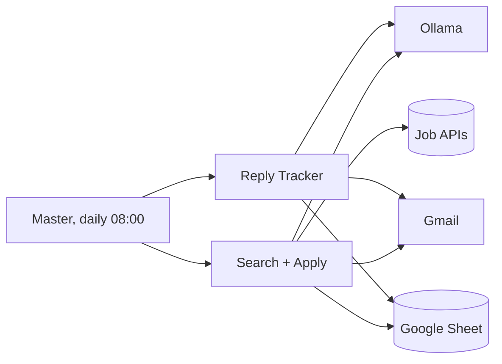

# Joby Job Agents

An n8n automation that finds job offers, matches them against your CV, writes a tailored cover letter for each one, checks that the letter does not lie, applies by email, and follows up. It runs locally with Docker and an Ollama model, so your CV is never sent to a cloud LLM.

> Status: working prototype. It ships in dry-run mode (Gmail drafts only). Read the drafts before you let it send anything.

## What it does

1. **Understands your request.** You describe what you want in plain words (PFE, internship, CDI, CDD, freelance, remote, city, domain). The LLM turns it into search terms, contract types, locations and exclusions.
2. **Searches** public job APIs: Remotive, RemoteOK, Arbeitnow, and optionally Jooble.
3. **Matches** each offer against your CV. The LLM writes its reasoning step by step, lists matched and missing skills, and returns a score from 0 to 100.
4. **Writes a cover letter** per offer, in the language of the posting, using only facts found in the CV.
5. **Fact-checks the letter.** A second LLM pass extracts every claim the letter makes about you and verifies it against the CV. Any unsupported claim sends the offer to manual review and nothing is sent.
6. **Applies** through Gmail with your CV attached, or creates a draft in dry-run mode.
7. **Never repeats.** Every offer has a stable `job_id`, and offers already in the sheet are filtered out before the LLM runs.
8. **Tracks replies** every day. The LLM classifies each reply (accepted, interview, rejected, needs action, acknowledged) and updates the sheet.
9. **Follows up** after 7 days without an answer, in the same Gmail thread. Maximum 2 follow-ups, then the application is closed. No sends on weekends.
10. **Emails you a digest** when new replies arrive.

## Architecture



| Workflow | File | Role |
|---|---|---|
| Job Agent 0 | `workflows/job-agent-0-master.json` | Runs the tracker, then search and apply, every day |
| Job Agent 1 | `workflows/job-agent-1-search-match-apply.json` | Search, match, letter, fact-check, apply |
| Job Agent 3 | `workflows/job-agent-3-reply-tracker.json` | Read replies, update status, follow up |

The stack in `docker-compose.yml`: PostgreSQL, Ollama (with a one-shot model pull), and n8n with the workflows imported on first start.

## Requirements

- Docker and Docker Compose
- 8 GB of free RAM or more for a 7B model (more for bigger models)
- A Google account (Gmail and Google Sheets)
- Your CV as a text PDF (not a scan)

## Quick start

```bash
git clone <your-repo-url>
cd <repo>/infra

cp .env.example .env
nano .env                       # fill in the values below
cp /path/to/your_cv.pdf n8n-files/cv.pdf

docker compose up -d
docker compose logs -f joby-ollama-init joby-n8n
```

The first start downloads the model (a few GB). Wait for `joby-ollama-init` to exit.

### Settings (`.env`)

| Variable | Meaning |
|---|---|
| `POSTGRES_PASSWORD` | Database password |
| `N8N_ENCRYPTION_KEY` | Random string. Keep it, n8n cannot read saved credentials without it |
| `JOB_SHEET_ID` | ID of your Google Sheet (the part of the URL between `/d/` and `/edit`) |
| `CANDIDATE_NAME` | Name used to sign the letters |
| `CV_FILE_NAME` | File name shown as the email attachment |
| `NOTIFY_EMAIL` | Where the reply digest is sent |
| `OLLAMA_MODEL` | Default `qwen2.5:7b-instruct` |
| `JOOBLE_API_KEY` | Optional |
| `DRY_RUN` | `true` creates drafts only. `false` sends real emails |
| `AUTO_ACTIVATE` | `true` activates the master workflow on start |

### Google setup

1. **Sheet.** Create a tab named `Applications`. Paste the header row from `sheet-headers.csv` into row 1.
2. **Cloud project.** In Google Cloud, enable the Gmail API, Google Sheets API and Google Drive API.
3. **OAuth client.** Create an OAuth client of type Web application with this redirect URI:
   ```
   http://localhost:5678/rest/oauth2-credential/callback
   ```
   Add your own Gmail address as a test user.
4. **n8n credentials.** Open http://localhost:5678, add Google Sheets OAuth2 and Gmail OAuth2 credentials with the client ID and secret, and sign in. Tick every permission box.
5. **Select the credentials** in every Gmail and Google Sheets node of the three workflows, and set the **Sheet** field of each Sheets node to your tab (by ID, the `gid` number in the sheet URL).

### Test, then go live

1. Keep `DRY_RUN=true`.
2. Open the Reply Tracker and click **Run Now**, then run Job Agent 1.
3. Check the Gmail drafts and the `letter_check` column in the sheet.
4. When you trust the output, set `DRY_RUN=false` and `AUTO_ACTIVATE=true`, then run `docker compose up -d joby-n8n`.

## Status values in the sheet

`to_apply`, `applied`, `draft_created`, `needs_review`, `manual_apply`, `skipped_low_score`, `acknowledged`, `interview`, `accepted`, `rejected`, `action_needed`, `bounced`, `closed_no_reply`, `error`

## How it avoids lying about you

- The matcher is told to use only facts written in the CV and to cap the score when a hard requirement is missing.
- The letter writer receives the missing skills as "do not claim".
- A separate fact-check pass compares each claim with the CV. A single unsupported claim blocks the send.
- Every LLM step stores its reasoning, so you can audit why an offer was chosen or skipped.

This reduces the risk. It does not remove it. A small local model can still miss a subtle claim, which is why dry-run mode is the default and why you should read the first letters yourself.

## Limitations

- Job sources are public APIs. LinkedIn and most local boards block bots and have no free API, so they are not included. You can add a source by outputting `{job_id, title, company, location, url, apply_email, description}` into the Normalize node.
- Applying works only when the posting contains an email address. Other offers are marked `manual_apply`.
- Reply tracking reads the Gmail thread of the original application. A recruiter who answers in a new thread is not detected.
- Quality depends on the model. A 7B model is a floor, not a target.

## Security and privacy

- Never commit `.env`, your CV, your sheet ID or exported credentials.
- The services bind to `127.0.0.1` only. Do not expose n8n to the internet without authentication and HTTPS.
- Google apps in Testing mode expire the login every 7 days. Publish the app (for personal use) to avoid re-signing in.
- Emails are sent from your own account. You are responsible for what is sent, so keep the volume low and the review step on.
